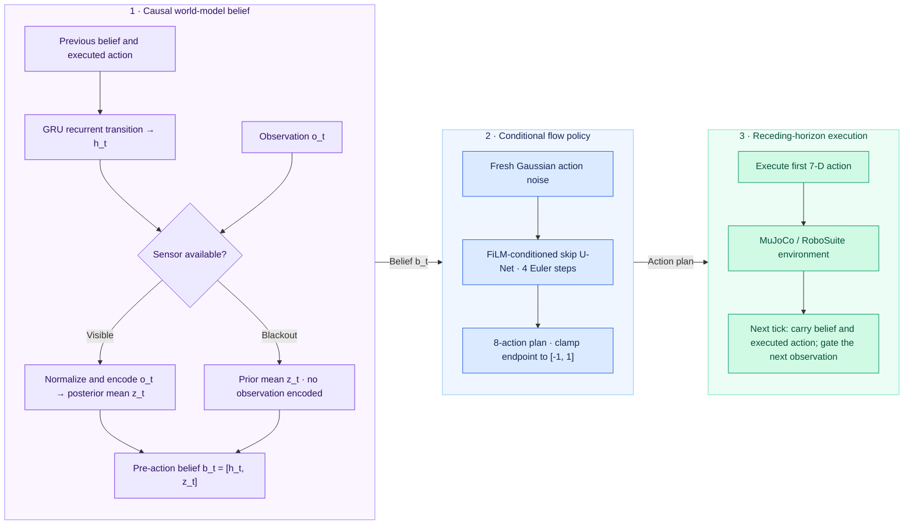

<div align="center">

# 🕶️ Blind-Diffusion

**Learn from demonstrations. Keep acting when observations stop.**

Causal world-model beliefs · Conditional flow matching · Robotic manipulation

[](docs/results/lift_flow_matching.json)
[](docs/validated_results.md)
[](docs/setup.md)
[](LICENSE)

[Results](#-verified-lift-result) · [Architecture](#-system-architecture) · [Quickstart](#-quickstart) · [Evidence](docs/validated_results.md)

</div>

Blind-Diffusion learns from offline robot demonstrations. A recurrent
state-space model (RSSM) remembers the scene; a conditional flow policy turns
that belief into actions, including during observation blackout.

## 📊 Verified Lift result

| Policy | Clean observations | Permanent blackout after 5 observations |
| --- | ---: | ---: |
| OT-path CFM, 4 Euler steps + RSSM prior | **95% (19/20)** | **90% (18/20)** |

RoboMimic Lift, low-dimensional observations, **one training seed and 20 paired
evaluation seeds**. The same checkpoint is used in both conditions. Success
means the environment task predicate becomes true within 500 steps; it does
not require a sustained hold until the final step.

**What this establishes:** this configuration learns clean and blind simulated
Lift control. A completed, fixed-checkpoint Can comparison is available below. Neither
comparison establishes baseline superiority, vision, real-robot, or measured
latency results.

[Recorded counts and per-seed outcomes](docs/results/lift_flow_matching.json)
· [Full protocol and evidence limits](docs/validated_results.md)

## Can comparison — temporary research snapshot

Success by 300 environment steps; 30 paired seeds per condition, one training
seed, unchanged selected checkpoints. Permanent blackout begins after five
visible observations.

| Method | Clean | Permanent blackout |
| --- | ---: | ---: |
| OT-path CFM, Euler-4 + RSSM prior | 21/30 (70%) | 21/30 (70%) |
| Bounded-x0 DDIM-10 + RSSM prior | 24/30 (80%) | 22/30 (73%) |
| Zero-input DDIM open-loop, 8-action chunks | 24/30 (80%) | 0/30 (0%) |
| Reactive behavior cloning | 5/30 (17%) | 0/30 (0%) |

On the same CFM trajectories, clean/blind completion rises from 8/30 and 10/30
by step 115 to 21/30 each by step 250; no method adds successes between steps
250 and 300. This supports a deadline effect without retraining. It does not
establish CFM superiority or reproduce external results with different seeds
and checkpoints. The open-loop baseline uses zero-input posterior updates
during blackout, rather than prior-only imputation.

[All blackout conditions, deadlines, validation and limitations](docs/results/can_horizon_comparison.md).
The historical Lift result above uses a separate evaluation protocol.

## 💡 The core idea

1. **Observe:** update the RSSM posterior from the current observation and the
   previous executed action: `belief[t] = posterior(obs[t], action[t-1])`.
2. **Remember:** during blackout, use the action-conditioned prior instead:
   `belief[t] = prior(belief[t-1], action[t-1])`. No new observations update it.
3. **Act:** generate an 8-action chunk using four Euler steps, execute its first
   action, and replan at the next environment step.

## 🧠 System architecture

The diagram shows the verified low-dimensional Lift configuration. The sensor
gate selects the posterior when visible and the prior during blackout;
both paths share the same recurrent transition. Inference uses latent means.



EMA weights are selected on held-out demonstrations. Alternative Euler step
counts and bounded-`x0` DDIM/DDPM remain available for comparison; the headline
result uses the four-step flow policy shown above.

The flow policy uses Gaussian optimal-transport conditional paths with
independent Gaussian/action pairs. It does **not** perform minibatch OT
assignment. Velocity and intermediate ODE states are unbounded; completed
native actions clamp once to `[-1, 1]`.

## 🔎 Evidence checks

- **Held-out demonstrations:** both training stages share a seeded 190/10
  episode split; normalization uses training demonstrations only.
- **Causal conditioning:** regression tests perturb future actions and verify
  that earlier decision beliefs remain unchanged.
- **Paired starts:** all 19 initial observation coordinates match exactly for
  every clean/blind pair in the reported run.
- **Sensor isolation:** after observations at steps 0–4, the blind controller
  uses only its remembered state and executed-action history. True observations
  may be logged for diagnostics but do not update its belief.

## 🚀 Quickstart

Use the [tested installation and dataset setup](docs/setup.md) first
(Python 3.10, PyTorch 2.4 + CUDA 12.4, MuJoCo 2.3.7).

```bash
python -m blind_diffusion.train.train_world_model --config-name train_world_model_recovery num_workers=0
python -m blind_diffusion.train.train_diffusion --config-name train_flow_matching_recovery num_workers=0
python -m blind_diffusion.eval.evaluate_diffusion --config-name eval_flow_matching exp_name=eval_clean episodes=20 seed=0
python -m blind_diffusion.eval.evaluate_diffusion --config-name eval_flow_matching exp_name=eval_blind episodes=20 seed=0 blackout_duration=20
```

Run the regression suite with `python -m pytest -q`. A short CUDA execution
check is available as `bash scripts/run_recovery_v2_smoke.sh`; it cannot establish
task performance with its small training budget.

<details>
<summary>Training protocol, limitations, and next comparisons</summary>

The reported run used 4,000 world-model updates and 100 policy epochs, batch
128, deterministic RSSM mean beliefs, padding masks, multi-step prior losses,
blackout-conditioned policy training, and EMA checkpoint selection by held-out
velocity loss. Evaluation used seeds 0–19 and Euler-4 receding-horizon control.
Blackout is permanent after the first five observations.

The data-handling, optimization, architecture, and objective changes were
introduced together. These results do not isolate which individual repair
caused historical failures. Historical failed runs are not a matched baseline
for an improvement percentage.

Next evidence to establish: additional training seeds, an isolated prior-only
imputation ablation, other tasks, and partial-modality or image-based control. Legacy bounded direct-`x0` DDIM/DDPM, latent MPC, and image entrypoints
remain available for experiments; their availability is not a validated result.

Raw checkpoints, datasets, private execution logs, and personal infrastructure
state are not distributed in this repository.

</details>

## 📁 Repository layout

```text
src/blind_diffusion/  world model, policies, training, evaluation, configs
scripts/             reproducible training and evaluation entrypoints
tests/               focused correctness and causality checks
docs/                setup, protocols, and curated result records
```

License: [MIT](LICENSE).
