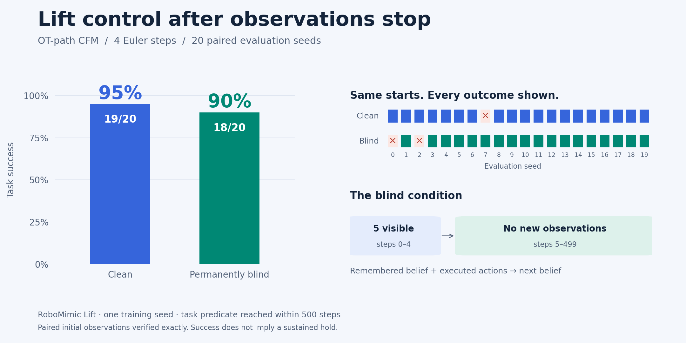
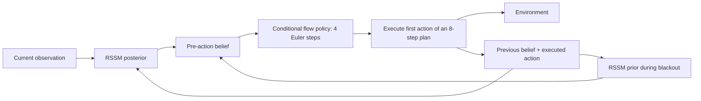

# Blind-Diffusion

**Learn from demonstrations. Act from a remembered belief when observations stop.**

Blind-Diffusion combines a recurrent state-space model (RSSM) with a generative
action policy for robotic manipulation. The validated recovery configuration
uses **conditional flow matching with Gaussian OT paths**, four Euler steps,
and receding-horizon execution.



## Validated result

| RoboMimic Lift | Task successes | Rate |
| --- | ---: | ---: |
| Clean: observations available throughout | 19 / 20 | **95%** |
| Blind: only the first five observations available | 18 / 20 | **90%** |

Both conditions use the same checkpoint, Euler-4 sampling, and evaluation seeds
0–19. All 19 initial observation coordinates match exactly for every pair.
After steps 0–4, the blind policy receives **no new observations**: its RSSM
prior propagates the remembered state using executed actions. This is permanent
blackout for the rest of each 500-step episode, rather than periodic recovery
of sensor input.

**Conclusion:** this configuration learns clean and blind Lift control. The
result covers **one training seed and one simulated low-dimensional task**.
Success means the environment's task predicate became true at any point; it
does not establish a sustained hold, real-robot transfer, or recovery from every
failure. Can, image-based control, latency comparisons, and superiority over
baselines are not independently validated by this result. The bundled changes
also do not identify which individual repair caused historical failures.

See the [public result summary](docs/results/lift_flow_matching.json),
[protocol and evidence limits](docs/validated_results.md), and
[figure-generation script](scripts/plot_lift_results.py).

## How it works



The causal convention is `belief[t] = posterior(obs[t], action[t-1])` when
visible, and `belief[t] = prior(belief[t-1], action[t-1])` when blind. The policy
then chooses `action[t]`. True observations can be logged for diagnostics during
blackout, but are not used to update the blind policy's belief.

The two training stages share a seeded **190/10 demonstration split** and
training-only normalization. Recovery training includes padding masks, short
demonstrations, deterministic beliefs, multi-step prior objectives, policy
blackout augmentation, and EMA selection by held-out velocity loss. The flow
field and intermediate ODE states are unbounded; completed native actions clamp
to `[-1, 1]` once at the endpoint.

“OT paths” refers to the Gaussian conditional path; this implementation uses
independent Gaussian/action pairs, not minibatch optimal-transport assignment.
Legacy bounded direct-`x0` diffusion with DDIM/DDPM remains available. The
95%/90% result above belongs specifically to the flow recovery configuration.

## Reproduce

Tested training environment: Linux, Python 3.10.22, PyTorch 2.4.0 + CUDA 12.4,
MuJoCo 2.3.7, RoboSuite 1.4.1, RoboMimic 0.3.0, and an NVIDIA T4. Use a clean
Python 3.10 environment; the commands below install the tested CUDA stack.

```bash
python3.10 -m venv .venv
source .venv/bin/activate
python -m pip install torch==2.4.0 torchvision==0.19.0 torchaudio==2.4.0 \
  --index-url https://download.pytorch.org/whl/cu124
python -m pip install -r requirements-vast.txt
python -m pip install mujoco==2.3.7 robosuite==1.4.1
python -m pip install --no-deps robomimic==0.3.0
python -m pip install -e .
export ROBO_DATA="$PWD/robomimic_datasets"
export MUJOCO_GL=egl PYOPENGL_PLATFORM=egl MPLBACKEND=Agg
```

Download the public Lift demonstrations and place them at the configured path:

```bash
python -m robomimic.scripts.download_datasets \
  --tasks lift --dataset_types ph --hdf5_types low_dim --download_dir "$ROBO_DATA"
cp "$ROBO_DATA/lift/ph/low_dim_v141.hdf5" "$ROBO_DATA/lift/low_dim_v141.hdf5"
```

Train the world model (4,000 updates), then the flow policy (100 epochs):

```bash
python -m blind_diffusion.train.train_world_model --config-name train_world_model_recovery
python -m blind_diffusion.train.train_diffusion --config-name train_flow_matching_recovery
```

Evaluate both conditions with the same seeds and checkpoints:

```bash
python -m blind_diffusion.eval.evaluate_diffusion --config-name eval_flow_matching \
  exp_name=eval_flow_clean episodes=20 seed=0 max_steps=500 blackout_duration=0
python -m blind_diffusion.eval.evaluate_diffusion --config-name eval_flow_matching \
  exp_name=eval_flow_blind episodes=20 seed=0 max_steps=500 \
  warmup_steps=5 blackout_period=20 blackout_duration=20
```

Metrics, per-episode seeds, and initial observations are written to
`runs/<exp_name>/diffusion_metrics.json`. For a small CUDA execution check before
full training, run `bash scripts/run_recovery_v2_smoke.sh`; its short training
budget cannot establish task performance. See the
[existing-Colab workflow](docs/colab_recovery.md) for isolated remote execution.

## Checks and figures

```bash
python -m pip install pytest
python -m pytest -q
python scripts/plot_lift_results.py
```

The figure is generated from a curated result summary. Checkpoints, datasets,
credentials, and private execution logs are not distributed with the result.
Reproducing the figure redraws the recorded counts; reproducing the experiment
requires training and evaluation above.

## Scope

- **Validated:** low-dimensional Lift with RSSM-conditioned OT-path flow control.
- **Available for experiments:** direct-`x0` diffusion, latent MPC, image encoders,
  and behavioral-cloning entrypoints.
- **Still to establish:** additional training seeds, more tasks, matched baseline
  comparisons, and controlled ablations of the recovery changes.

Source: [`src/blind_diffusion/`](src/blind_diffusion/). License: [MIT](LICENSE).
