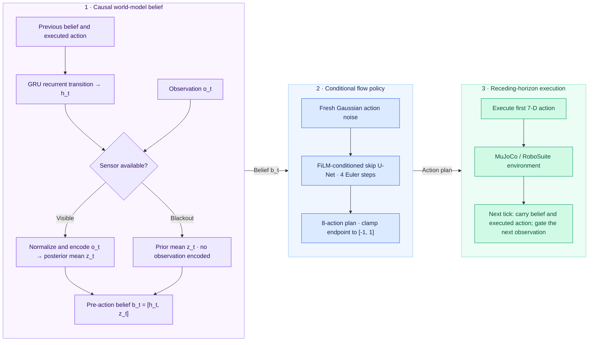

<div align="center">

# 🕶️ Blind-Diffusion

**Learn from demonstrations. Keep acting when observations stop.**

Causal world-model beliefs · Conditional flow matching · Robotic manipulation

[](docs/results/matched_summary.json)
[](docs/results/matched_summary.json)
[](docs/results/can_horizon_comparison.md)
[](docs/setup.md)
[](LICENSE)

[Results](#-matched-blackout-results) · [Architecture](#-system-architecture) · [Quickstart](#-quickstart) · [Evidence](docs/results/matched_baselines_v1.md)

</div>

Blind-Diffusion learns from offline robot demonstrations. A recurrent
state-space model (RSSM) remembers the scene; a conditional flow policy turns
that belief into actions, including during observation blackout.

## 📊 Matched blackout results

**Keep acting after observations stop: 90% Lift and 70% Can success under
permanent blackout with our four-step flow controller.** Both evaluated
zero-input baselines reach 0% in that condition. CFM uses four model evaluations
per plan versus ten for bounded-x0 DDIM, which remains competitive in accuracy.

After five visible observations, D is the number of missing-observation steps
in each 20-step cycle: D=5/10/15 corresponds to 25%/50%/75% scheduled blackout;
D=20 is permanent blackout. Every method uses the same paired starts within a
task. Results use one training seed; counts are shown to make sample sizes clear.

### Lift · 50 paired seeds · 500-step deadline

| Method | Clean | D=5 | D=10 | D=15 | Permanent blackout |
| --- | ---: | ---: | ---: | ---: | ---: |
| **OT-path CFM-4 + RSSM prior (ours)** | 49/50 (98.0%) | 50/50 (100.0%) | 50/50 (100.0%) | 48/50 (96.0%) | 45/50 (90.0%) |
| OT-path CFM-2 + RSSM prior | 45/50 (90.0%) | 47/50 (94.0%) | 47/50 (94.0%) | 46/50 (92.0%) | 44/50 (88.0%) |
| Bounded-x0 DDIM-10 + RSSM prior | 49/50 (98.0%) | 49/50 (98.0%) | 47/50 (94.0%) | 48/50 (96.0%) | 45/50 (90.0%) |
| DDIM-10 chunks, zero-input posterior | 50/50 (100.0%) | 50/50 (100.0%) | 34/50 (68.0%) | 11/50 (22.0%) | 0/50 (0.0%) |
| Reactive BC, zero-input blackout | 44/50 (88.0%) | 49/50 (98.0%) | 24/50 (48.0%) | 0/50 (0.0%) | 0/50 (0.0%) |
| Latent CEM MPC, learned sparse reward | 0/50 (0.0%) | 0/50 (0.0%) | 0/50 (0.0%) | 0/50 (0.0%) | 0/50 (0.0%) |

### Can · 30 paired seeds · 300-step deadline

| Method | Clean | D=5 | D=10 | D=15 | Permanent blackout |
| --- | ---: | ---: | ---: | ---: | ---: |
| **OT-path CFM-4 + RSSM prior (ours)** | 21/30 (70.0%) | 26/30 (86.7%) | 26/30 (86.7%) | 26/30 (86.7%) | 21/30 (70.0%) |
| Bounded-x0 DDIM-10 + RSSM prior | 24/30 (80.0%) | 26/30 (86.7%) | 22/30 (73.3%) | 25/30 (83.3%) | 22/30 (73.3%) |
| DDIM-10 chunks, zero-input posterior | 24/30 (80.0%) | 7/30 (23.3%) | 6/30 (20.0%) | 0/30 (0.0%) | 0/30 (0.0%) |
| Reactive BC, zero-input blackout | 5/30 (16.7%) | 0/30 (0.0%) | 0/30 (0.0%) | 0/30 (0.0%) | 0/30 (0.0%) |

For CFM-4, Can success averaged over the four blackout conditions is **82.5%**
versus **79.2%** for DDIM-10. This descriptive average reuses the same 30 seeds
across conditions; it is not an independent 120-trial experiment or evidence
of a statistically established algorithm ranking. At permanent blackout,
CFM and DDIM differ by just one success (21/30 versus 22/30).

The Can extension reused the selected checkpoints without retraining. On the
same CFM trajectories, clean/blind success rises from 8/30 and 10/30 by step
115 to 21/30 each by step 250; no method adds successes from 250 to 300.
The original 115-step benchmark is retained separately.

### Controller computation · measured batch-one latency

| Task | CFM-4 GPU median / p95 | DDIM-10 GPU median / p95 |
| --- | ---: | ---: |
| Lift | **10.76 / 10.90 ms** | 29.37 / 30.08 ms |
| Can | **10.16 / 10.22 ms** | 28.30 / 29.57 ms |

Visible-observation controller microbenchmark on an NVIDIA RTX 4000 Ada,
PyTorch 2.4: 20 warmups, 200 measured queries, synchronized GPU timing,
excluding environment simulation. DDIM/CFM median latency ratios are 2.7–2.8×
on this hardware; these measurements are not
end-to-end robot throughput. [Lift timing records](docs/results/latency_lift.json)
· [Can timing records](docs/results/latency_can.json).

**Read the comparison correctly.** DDIM uses bounded direct-x0 prediction.
The open-loop baseline executes eight-action chunks and feeds zero normalized
observations into the RSSM posterior during blackout, rather than using the
prior-only branch. BC is a reactive MLP; its weak clean Can score limits broad
claims about BC. Latent MPC uses our learned sparse reward and its failure
does not establish that MPC generally fails. The open-loop comparison changes
both observation handling and execution frequency; an isolated prior ablation
and additional training seeds remain future work.

[Aggregate counts and confidence intervals](docs/results/matched_summary.json)
· [Original full comparison and protocol](docs/results/matched_baselines_v1.md)
· [Can deadlines, validation and limitations](docs/results/can_horizon_comparison.md)
· [Historical 20-pair Lift recovery](docs/validated_results.md)

## 💡 The core idea

1. **Observe:** update the RSSM posterior from the current observation and the
   previous executed action: `belief[t] = posterior(obs[t], action[t-1])`.
2. **Remember:** during blackout, use the action-conditioned prior instead:
   `belief[t] = prior(belief[t-1], action[t-1])`. No new observations update it.
3. **Act:** generate an 8-action chunk using four Euler steps, execute its first
   action, and replan at the next environment step.

## 🧠 System architecture

The diagram shows the low-dimensional CFM-4 controller evaluated on Lift and Can. The sensor
gate selects the posterior when visible and the prior during blackout;
both paths share the same recurrent transition. Inference uses latent means.



EMA weights are selected on held-out demonstrations. Alternative Euler step
counts and bounded-`x0` DDIM/DDPM remain available for comparison; the
CFM-4 rows use the four-step flow policy shown above.

The flow policy uses Gaussian optimal-transport conditional paths with
independent Gaussian/action pairs. It does **not** perform minibatch OT
assignment. Velocity and intermediate ODE states are unbounded; completed
native actions clamp once to `[-1, 1]`.

## 🔎 Evidence checks

- **Held-out demonstrations:** both training stages share a seeded 190/10
  episode split; normalization uses training demonstrations only.
- **Causal conditioning:** regression tests perturb future actions and verify
  that earlier decision beliefs remain unchanged.
- **Paired starts:** restored simulator states and observations match exactly
  across methods and blackout conditions within each matched evaluation run.
- **Sensor isolation:** after observations at steps 0–4, the blind controller
  uses only its remembered state and executed-action history. True observations
  may be logged for diagnostics but do not update its belief.

## 🚀 Quickstart

The commands below reproduce the original Lift recovery configuration. For
matched protocols, use `scripts/run_matched_campaign.py --help` and the
[Can extension instructions](docs/results/can_horizon_comparison.md).

Use the [tested installation and dataset setup](docs/setup.md) first
(Python 3.10, PyTorch 2.4 + CUDA 12.4, MuJoCo 2.3.7).

```bash
python -m blind_diffusion.train.train_world_model --config-name train_world_model_recovery num_workers=0
python -m blind_diffusion.train.train_diffusion --config-name train_flow_matching_recovery num_workers=0
python -m blind_diffusion.eval.evaluate_diffusion --config-name eval_flow_matching exp_name=eval_clean episodes=20 seed=0
python -m blind_diffusion.eval.evaluate_diffusion --config-name eval_flow_matching exp_name=eval_blind episodes=20 seed=0 blackout_duration=20
```

Run the regression suite with `python -m pytest -q`. A short CUDA execution
check is available as `bash scripts/run_recovery_v2_smoke.sh`; it cannot establish
task performance with its small training budget.

<details>
<summary>Training protocol, limitations, and next comparisons</summary>

The matched campaign used 4,000 world-model updates and 100 policy epochs,
batch 128, deterministic RSSM mean beliefs, padding masks, multi-step prior
losses, blackout-conditioned policy training, and EMA checkpoint selection
on held-out demonstrations. Evaluation used seeds 0–49 for Lift and 0–29
for Can, paired across methods and conditions. Protocol files record each
method's objective, selection criterion and inference budget.

The data-handling, optimization, architecture, and objective changes were
introduced together. These results do not isolate which individual repair
caused historical failures. Historical failed runs are not a matched baseline
for an improvement percentage.

Next evidence to establish: additional training seeds, an isolated prior-only
imputation ablation, other tasks, and partial-modality or image-based control.
Image entrypoints remain experimental; the low-dimensional results above do
not establish image-control performance.

Raw checkpoints, datasets, private execution logs, and personal infrastructure
state are not distributed in this repository.

</details>

## 📁 Repository layout

```text
src/blind_diffusion/  world model, policies, training, evaluation, configs
scripts/             reproducible training and evaluation entrypoints
tests/               focused correctness and causality checks
docs/                setup, protocols, and curated result records
```

License: [MIT](LICENSE).
